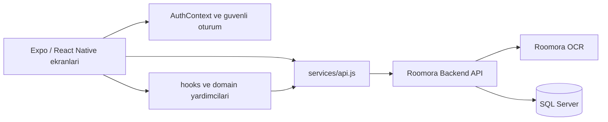
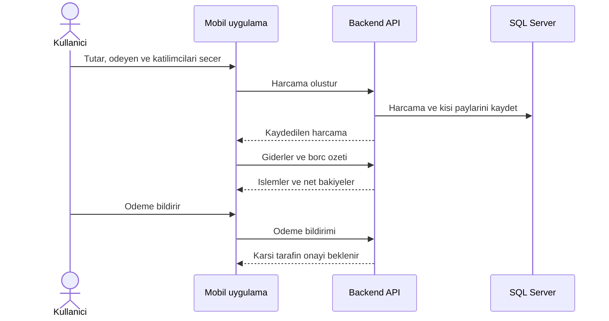

# Mobil akış

`App.js` provider'lari ve navigation'i kurar. `src/screens/roomora` ana akislari tasir; `src/screens` altindaki form ve ayrinti ekranlari bu akislardan acilir. `src/services/api.js` HTTP sozlesmesini, `src/shared` ortak tema, i18n ve oturum yardimcilarini tutar. Borc hesaplamasi telefonda yeniden icat edilmez; sunucudan gelen ledger bakiyesi gosterilir.

## Demo materyal

Magaza goruntuleri `scripts/capture-demo-store.mjs` ile yerel web export'undan ve yakalanan sahte API yanitlarindan uretilir. Script canli API'ye veya gercek kullanici hesabina baglanmaz. Bu dosyalar urun anlatimi icindir; iOS magazasina yerlestirilmeden once Apple'in cihaz yakalama gereklilikleri ayrica dogrulanmalidir.
