# Roomora kullanım kılavuzu

Ev, gezi ve arkadaş gruplarında ortak harcamaları kaydetmek, paylaştırmak ve kimin kime ne kadar borçlu olduğunu görmek için. Bu kılavuzdaki ekranlar sahte adlar ve boş bir test eviyle çekilmiştir; gerçek hesabınızda tutarlar ve üyeler farklı görünür. Ekran görüntüleri mobil genişlikte web önizlemesidir. iPhone ve Android sistem izin pencereleri farklı olabilir.

## 1. Hesaba giriş ve grup

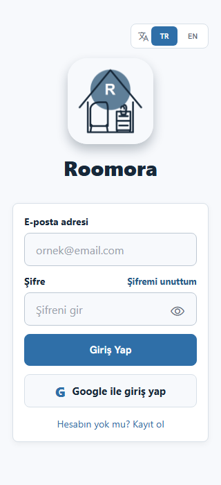

1. **E-posta adresi** ve **Şifre** alanlarını doldurup **Giriş Yap**'a dokunun. Göz simgesi şifreyi gösterir/gizler.
2. **Google ile giriş yap** Google hesabıyla oturum açar. **Hesabın yok mu? Kayıt ol** yeni hesap akışına gider.
3. Şifrenizi hatırlamıyorsanız **Şifremi unuttum**'a dokunun, e-posta adresinizi yazıp **Kod Gönder**'i seçin. Gelen kodla şifrenizi yenileyin.

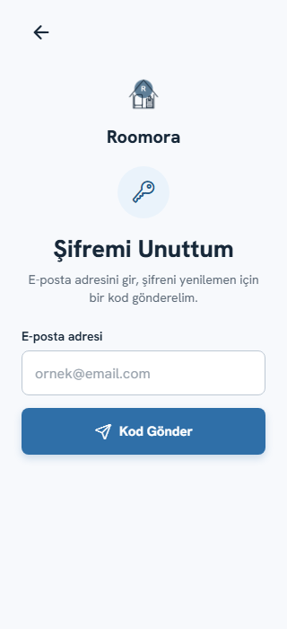

**Ayarlar > Evlerim ve Favori Ev** evlerinizi ve gezi gruplarınızı yönetir. Henüz grubunuz yoksa **Yeni Ev Oluştur** ile bir grup kurun. Bir gruba davet edildiyseniz davet bağlantısını kendi hesabınızla açın. İşlem yapmadan önce ana ekranda doğru grubun adını kontrol edin.

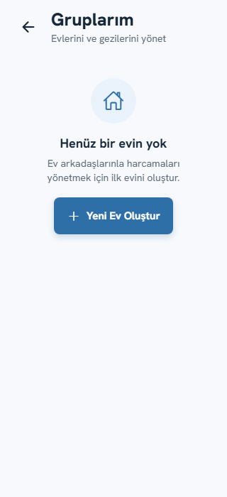

## 2. Ana ekran

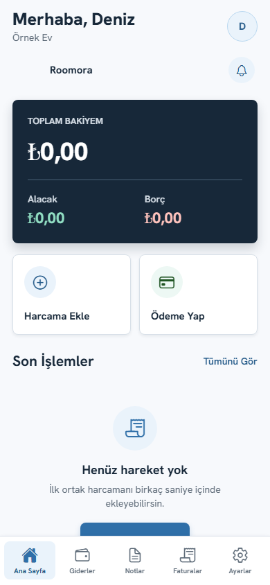

- Üstteki grup adı, işlemlerin hangi ev veya geziye yazılacağını gösterir. Profil simgesi hesap bilgilerinize, zil simgesi bildirimlere gider.
- **Toplam bakiyem**, **Alacak** ve **Borç** o gruptaki mevcut durumunuzu özetler. Daha ayrıntılı kişi bazlı durum için borç/alacak özetini açın.
- **Harcama Ekle** yeni gider formunu, **Ödeme Yap** bir üyeye yaptığınız ödemeyi bildirme ekranını açar.
- **Son İşlemler > Tümünü Gör** kayıtlı hareketlere gider. Alttaki beş sekme: **Ana Sayfa**, **Giderler**, **Notlar**, **Faturalar**, **Ayarlar**.

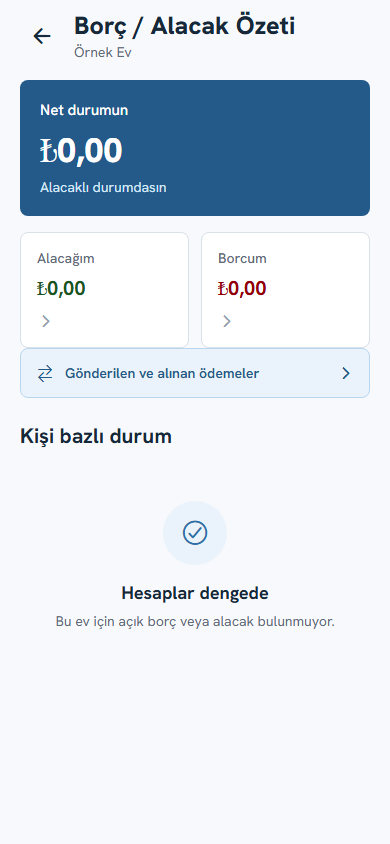

Borçlar kendi kendine ödenmiş sayılmaz. Gerçekte para aktarıldığında ödemeyi uygulamada da kaydetmek gerekir. Kişi satırlarına dokunarak ilgili kişiyle bakiye ve işlemleri inceleyin.

## 3. Market alışverişini elle ekleme

Örnek: Deniz 600 TL'lik market alışverişini üç arkadaş için ödedi.

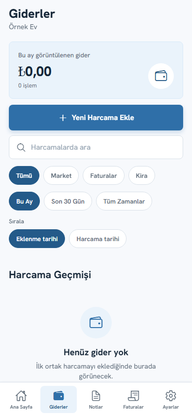

1. **Giderler > Yeni Harcama Ekle**'ye dokunun. Ana ekrandaki **Harcama Ekle** de aynı formu açar.
2. Üstteki **Harcama Tutarı** alanına `600` yazın; **Harcama adı**na `Market alışverişi` girin.
3. **Kategori** olarak **Market**'i seçin.
4. **Ödeyen** bölümünde parayı gerçekte ödeyen kişiyi seçin. İsmin üzerine dokunmak onu seçer.
5. **Kimin için?** bölümünde **Ortak** tüm ev/grup üyelerini seçer. Yalnız ilgili kişiler paylaşacaksa isimlere dokunarak seçimi değiştirin. En az bir kişi seçili kalmalıdır.
6. Herkes eşit pay alacaksa başka ayar yapmayın. Örnekte üç kişiye 200'er TL dağılır. Kontrol özetine bakıp **Harcamayı Kaydet**'e dokunun. Kaydetmeden formu terk etmek kayıt oluşturmaz.

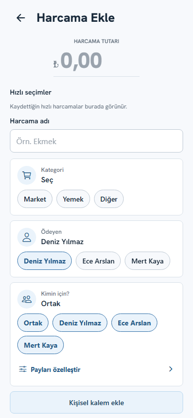

**Kişisel kalem ekle** ortak alışveriş içinde bir kişiye ait sabit bir tutarı ayırır; kalan tutar seçili kişilere bölünür. **Payları özelleştir** ise eşitsiz kullanım içindir. Kişi satırını açıp **+** ile ek pay verin; bir arkadaşın misafirinin payını o ev üyesine yazmak için açıklama girin. Örneğin 400 TL'de Deniz 1, Ece 2, Mert 1 pay alırsa tutarlar 100/200/100 TL olur. **Uygula** ile forma dönün; asıl harcama ancak **Harcamayı Kaydet** ile kaydolur.

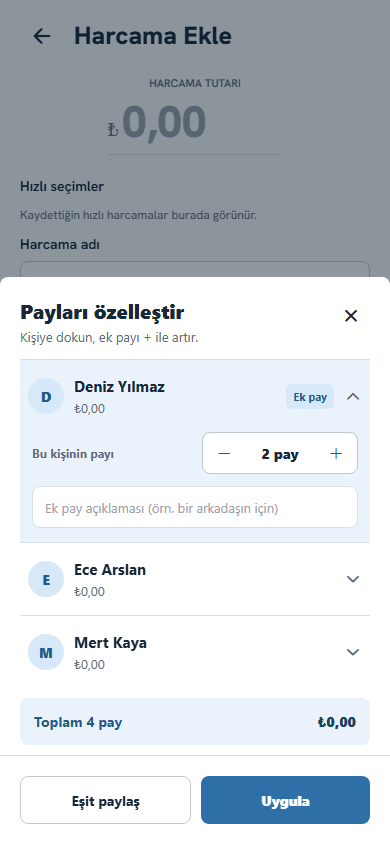

**Hızlı harcama olarak kaydet**, tutar/kategori/ödeyen/paylaşım seçimlerini daha sonra yeniden doldurmak için bu formu kişisel bir şablon olarak saklar. Kayıtlı hızlı seçime dokununca alanlar doldurulur, harcama otomatik kaydolmaz. Hızlı seçimin yanındaki çarpı onu kaldırır. Şablon kaydı için önce zorunlu alanları doldurun.

## 4. Fişle market harcaması ekleme

1. **Harcama Ekle** ekranının altındaki **Kamerayı Aç** veya **Galeriden Seç** ile okunabilir bir fiş fotoğrafı seçin. Fotoğraf yüklenirken tarama göstergesi görünür.

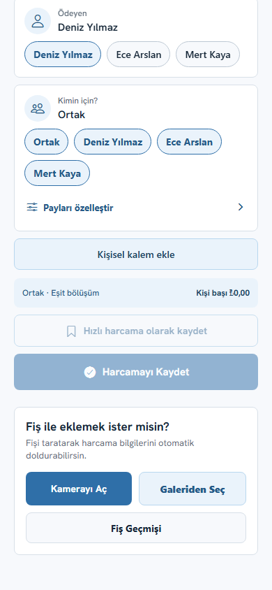

2. **Fiş Tarama Sonucu** ekranında market adı, fiş tarihi, eklenme tarihi, toplam ve kalemleri kontrol edin. OCR tahmini kesin değildir; özellikle indirim, iade ve ara toplam satırlarını elle doğrulayın.
3. Yanlış okunan ürüne dokunup **Kalemi düzenle** penceresinde adı, kalem tutarını ve **Kimin için?** kişilerini değiştirin. **Payları özelleştir** burada da vardır. **Kaydet** değişikliği uygular; **Vazgeç** veya panel dışına dokunmak pencereyi kapatır.
4. Gereksiz bir satırı silin, atlanan ürün varsa kalem ekleyin. Fiş toplamıyla kalemler/indirimler tutarlı olmadan harcamaya çevirmeyin.
5. Her kalemin paylaşımını ayrı ayrı belirleyin. Son onayda ödeyen ve tutarları tekrar kontrol edip fişi harcamaya dönüştürün. Böylece gider kaydı oluşur.

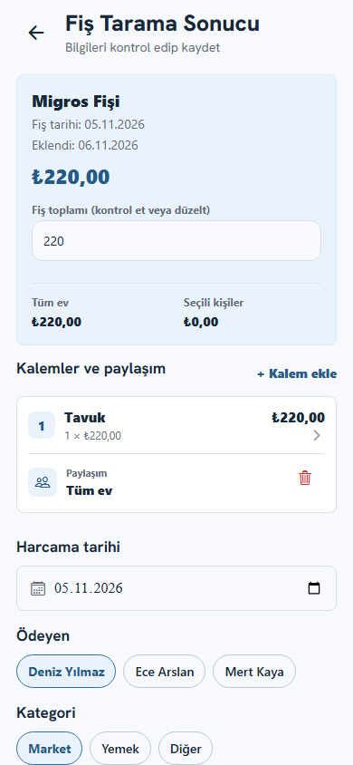

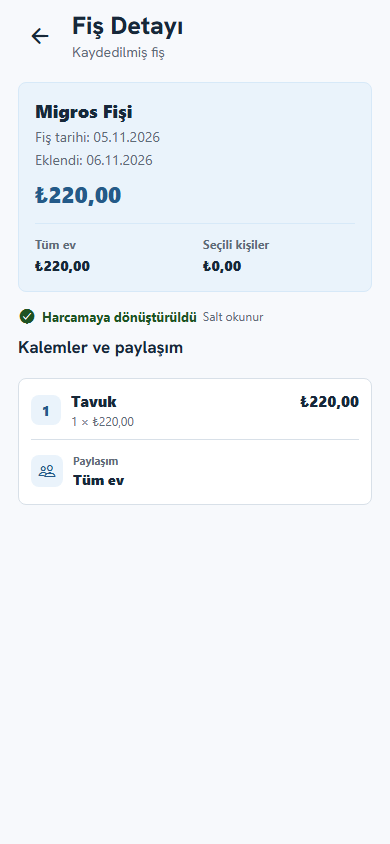

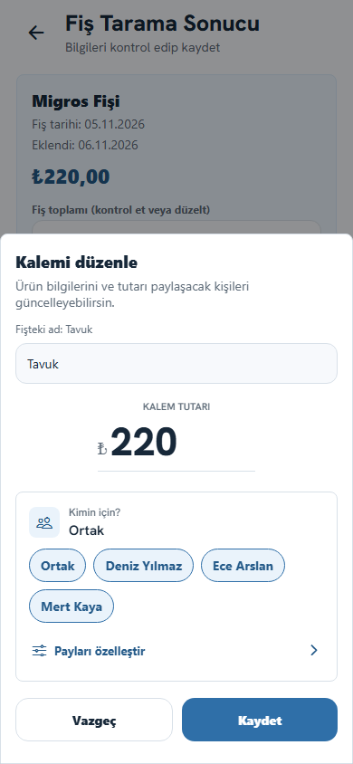

Dönüştürülmüş fiş **salt okunur** durumdadır; bağlı harcamayı **Giderler** üzerinden açın. **Fiş Geçmişi** daha önce yüklenen fişleri gösterir. Dönüştürülmemiş bir taslağı satır üzerinden sola kaydırarak silme işlemini başlatabilirsiniz; onaydan sonra listede görünmez. Yalnız fiş taslağını silmek, zaten oluşmuş bir harcamayı geri almaz. Giderlerde **Eklenme tarihi** ve **Harcama tarihi** sıralama seçenekleri farklı amaçlara hizmet eder: yeni yüklenen eski tarihli fiş için eklenme tarihini seçin.

## 5. Giderleri bulma ve düzenleme

- **Harcamalarda ara** adla arar. Kategori filtreleri (**Tümü**, **Market**, **Faturalar**, **Kira**), zaman filtreleri (**Bu Ay**, **Son 30 Gün**, **Tüm Zamanlar**) ve **Sırala** seçimleri listeyi daraltır.
- Bir gider satırına dokunup ayrıntısını açın. Kaynağı fiş ise ürün/kalem bazlı paylaşımı inceleyin; düzeltme gerekiyorsa düzenleme akışını kullanın. Değişiklikten sonra grup bakiyesini tekrar kontrol edin.
- Bir kaydı kaldıracaksanız işlem onayını okuyun. Finansal kayıtların görünürlük ve geçmiş davranışı işlem türüne göre değişir; yanlış kaydı sessizce yok saymayın.

## 6. Faturalar ve düzenli giderler

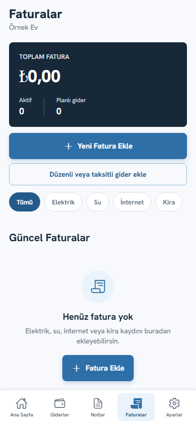

**Faturalar > Yeni Fatura Ekle** tekil elektrik, su, internet, kira ve benzeri faturayı kaydeder. **Düzenli veya taksitli gider ekle** yinelenen ya da vadeli harcamalar içindir. Sekmedeki kategori filtreleri ilgili faturayı bulur; karttaki durum etiketi o kaydın uygulamadaki durumunu gösterir.

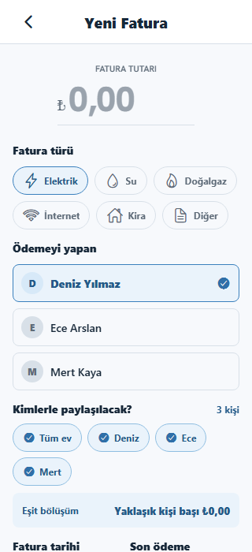

1. Fatura tutarını ve türünü seçin.
2. **Ödemeyi yapan** gerçekte parayı kuruma ödeyen kişidir; bu, diğer üyelerin ona olan paylarını hesaplamak için önemlidir.
3. **Kimlerle paylaşılacak?** bölümünde tüm evi veya ilgili kişileri seçin. Eşit bölüşüm özetini kontrol edin.
4. Fatura tarihi ve gerekiyorsa son ödeme bilgisini girin; ödendiyse durum/ödeme alanlarını gerçeğe uygun tamamlayın. Ardından kaydedin.

Bir faturanın kuruma ödenmesiyle ev arkadaşlarının birbirine olan borcu ayrı kavramlardır. Kuruma ödeme yapmış kişinin alacağı, diğerleri ona gerçekte para aktarıp ödemeyi uygulamada bildirdiğinde azalır.

## 7. Üyelere ödeme ve onay

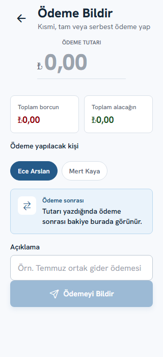

1. Ana ekrandan **Ödeme Yap**'a dokunun.
2. **Ödeme Tutarı**'na gerçekte gönderdiğiniz miktarı yazın. **Toplam borcun/alacağın** özetini okuyun.
3. **Ödeme yapılacak kişi** alanında alıcıyı seçin. Açıklama (örneğin `Kasım market payı`) yazabilirsiniz.
4. **Ödemeyi Bildir** ile bildirimi gönderin. Buton gerekli alanlar dolmadan etkinleşmez. Alıcı tarafında onay bekleyen ödemeleri kontrol edin; para transferini uygulama yapmaz.

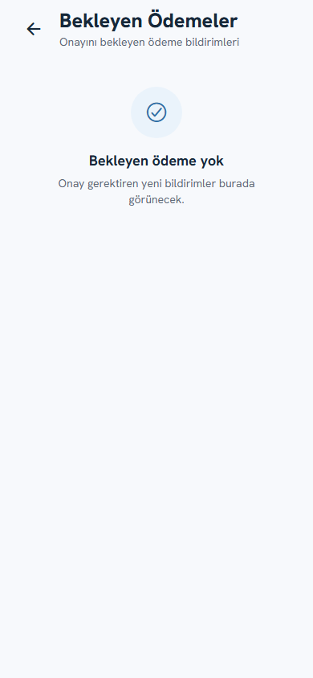

Onay veya ret kararını gerçek banka/elden ödeme durumunu kontrol ederek verin. **Gönderilen ve alınan ödemeler** işlem geçmişini gösterir.

## 8. Notlar, üyeler ve davet

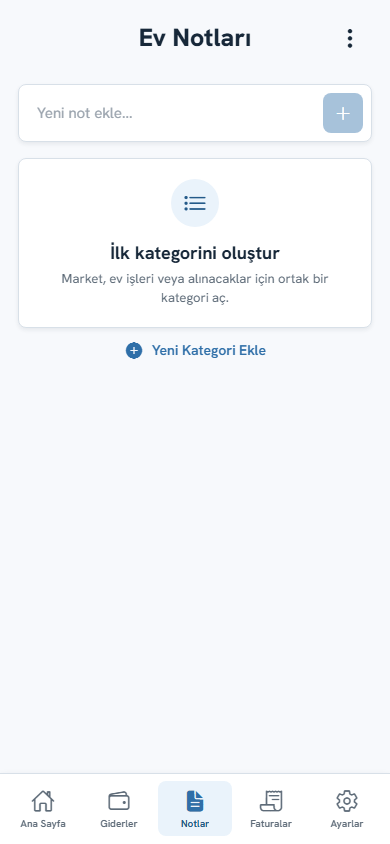

**Notlar** ortak ev/grup listeleridir. Yeni not veya kategori ekleyin, listeye madde yazın, tamamlananı işaretleyin. Kalem düzenleme ve silme simgeleri ilgili nota/öğeye uygulanır; finansal harcama yerine geçmez.

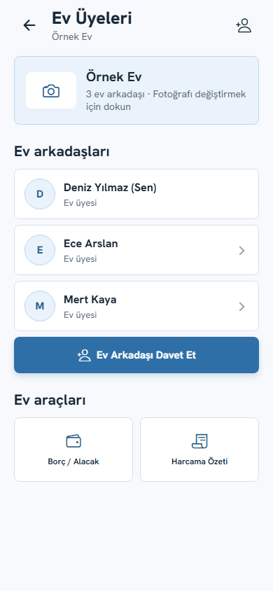

**Ev Üyeleri** grubun kimlerden oluştuğunu gösterir. Yeni birini eklemek için grup içindeki davet akışını kullanın; davet edilen kişinin doğru hesapla katıldığını ve grup adını kontrol edin. Gezi için ayrı grup açmak, ev giderleriyle tatil harcamalarının karışmasını önler.

## 9. Bildirimler ve ayarlar

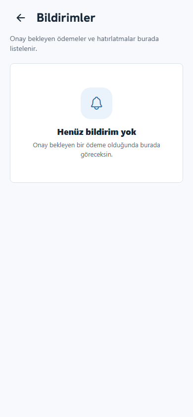

Zil, uygulama içindeki bildirim merkezini açar. Telefon bildirimi gelmesi için hem işletim sisteminde Roomora izni hem de **Ayarlar > Bildirim Ayarları**'ndaki ilgili anahtar açık olmalıdır. Bildirim gelmezse internet bağlantısını, cihaz iznini ve uygulamanın güncel sürümünü kontrol edin. Grup harcama bildirimleri sunucu dağıtımına da bağlıdır; yalnız uygulama anahtarının açık olması tek başına teslim garantisi değildir.

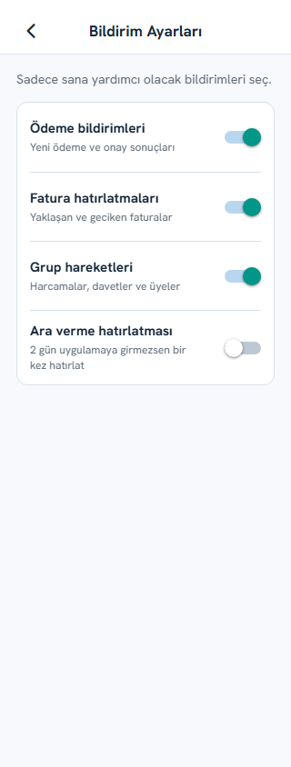

**Ödeme bildirimleri**, **Fatura hatırlatmaları**, **Grup hareketleri** ve **Ara verme hatırlatması** birbirinden bağımsızdır. Sonuncusu iki gün uygulamaya girmediğinizde yerel bir hatırlatıcı planlar.

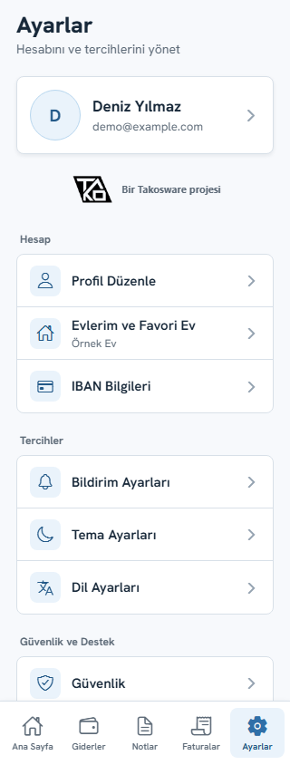

- **Profil Düzenle** ad, telefon, profil fotoğrafı ve isteğe bağlı IBAN'i yönetir. **IBAN Bilgileri** ödeme almayı kolaylaştıran ayrı IBAN alanıdır; uygulama banka transferi yapmaz.
- **Evlerim ve Favori Ev** etkin grubu değiştirir. Yeni harcama eklemeden önce seçili grubun adına bakın.
- **Tema Ayarları** açık/koyu görünümü, **Dil Ayarları** Türkçe/İngilizce görünümü seçmenizi sağlar.
- **Güvenlik**, **Gizlilik Politikası**, **Kullanım Koşulları** ve **Hakkında** hesap ve ürün bilgilerini açıklar. **Çıkış Yap** oturumu kapatır; kayıtları silmez.

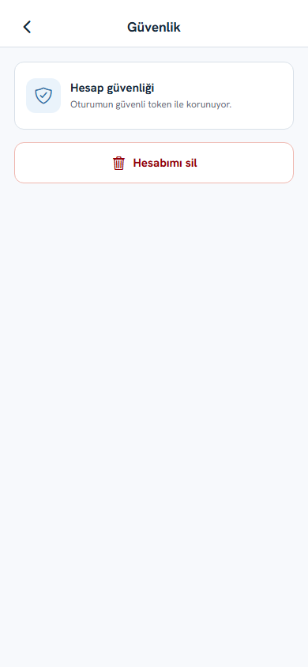

**Güvenlik > Hesabımı sil** kalıcı hesap kapatma akışını başlatır; yanlışlıkla dokunmayın, onay metnini dikkatle okuyun. Bu, **Çıkış Yap** ile aynı işlem değildir. **Gizlilik Politikası** hangi verilerin kullanıldığını, **Kullanım Koşulları** hizmetin kapsamını gösterir.

| Gizlilik | Kullanım koşulları |
|---|---|
| 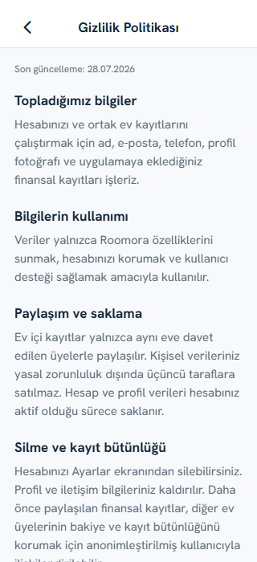 | 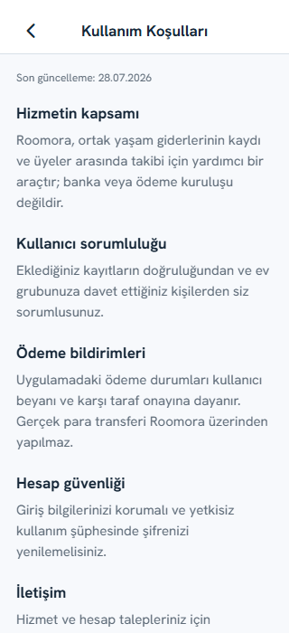 |

| Profil | IBAN | Tema | Dil |
|---|---|---|---|
| 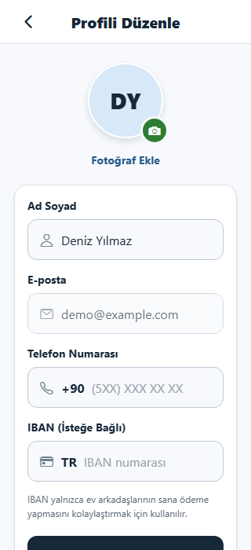 | 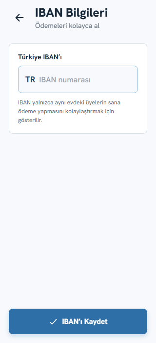 | 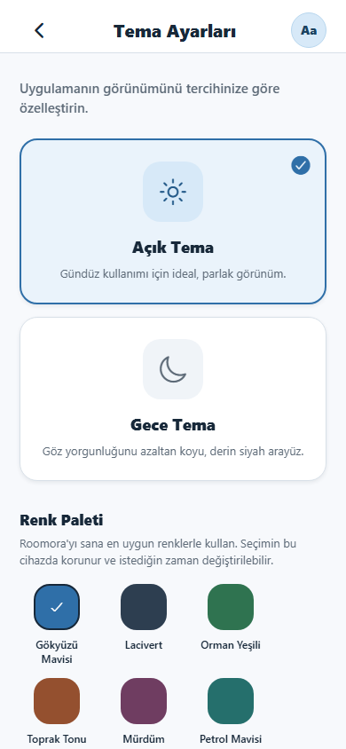 | 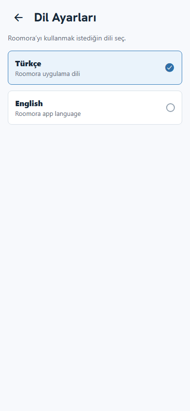 |

## 10. Kontrol listesi

- Doğru hesap ve doğru grup seçili mi?
- Harcamada tutar, ödeyen, kategori ve katılımcılar doğru mu?
- Fişte ara toplam/ödeme satırı ürün sanılmış mı; indirimler doğru yansımış mı?
- Özel pay kullandıysanız toplam pay ve kişi tutarları beklediğiniz gibi mi?
- Fatura gerçekte ödendi mi, yoksa yalnızca son ödeme tarihi mi girildi?
- Ödemeyi uygulamada bildirmeden önce gerçekte gönderdiniz mi?

Bu kılavuz 6 Kasım 2026 tarihli `testing` UI sürümüne göre hazırlanmıştır. Ekranların bir kısmı kayıtsız örnek evi gösterir; kamera, yerel bildirim ve banka işlemleri görüntülerden doğrulanamaz.
